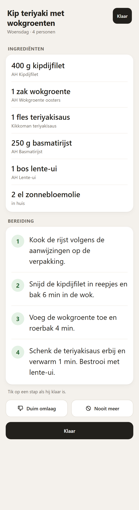
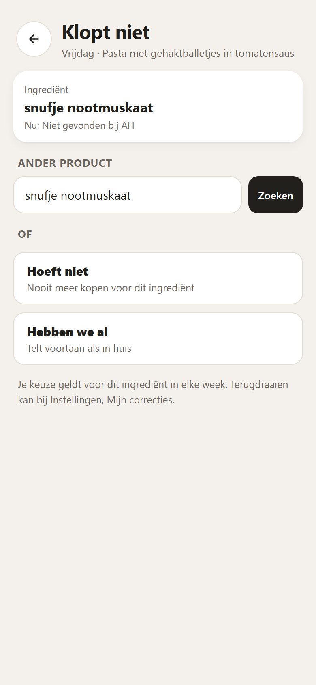

# Screenshots

Screenshots of the Weekmenu app at version 1.0, made by `weekmenu/tests/test_frontend.py` in headless Chrome at phone size (390 px wide). The data is test data: no real menu, account or order. Without Allerhande photos each dish shows its colour block. The mockups from before the app was built are gone; these are the real screens.

| | |
|---|---|
|  |  |
|  |  |
|  |  |
|  |  |
|  | |

1. Week: under the title the order it is for ("Voor de bestelling van woensdag 4 november"), then "Check voor je bestelt" (what is not found, with Zoek product and Hoeft niet, and what to check, with the counts; a green tick "Alles staat klaar" when nothing is left), then "Vanavond", then the savings of the week, then one card per evening, an evening not at home and a leftover night as quiet cards, and under the dishes "Ook in de bonus": staples bought often that are on offer, each with a plus button
2. One dish: the Koken button, persons, ingredients with the AH product and the bonus offer, "Klopt niet" on every ingredient line, preparation and swap, Duim omlaag and Nooit meer
3. Koken: the recipe amounts big with the AH product small under each, numbered steps you tap off, Duim omlaag and Nooit meer, and Klaar; the screen stays on while it is open
4. Klopt niet: one ingredient line with three choices: another product (search at AH and pick one), Hoeft niet, Hebben we al
5. Aanbiedingen: the whole bonus folder of the menu week per category with a search field on top, each product with its photo, the action, the price and a plus button
6. Besparing: this month and since the start (the estimate), the bars per week, "Echt bespaard (nagerekend)" per delivered week (or "niet na te rekenen"), and the two numbers over the last four weeks
7. Instellingen: the same helpers as in Home Assistant, Nieuw menu and Nu maken, Mijn correcties and Nooit meer (each with Terugdraaien), Diagnose and the AH login
8. Login: a step plan (on a computer: open the link, F12 and Console, log in, copy the `appie://login-exit?code=` line, paste it here, also from a phone)
9. Welcome: the first start, without a login or a menu: what the add-on does in three steps
