# Screenshots

Mockups with example data, made before the app was built. They show the intended direction, not the final app.

| | |
|---|---|
| 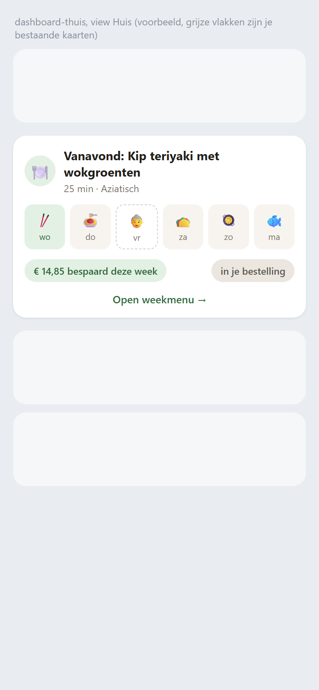 | 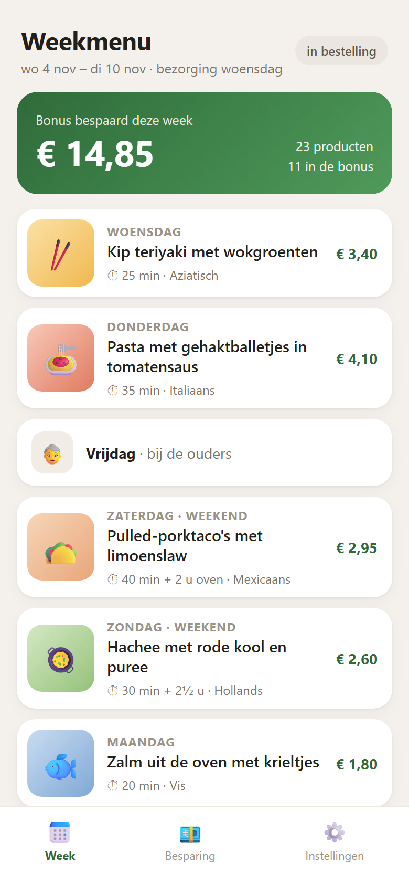 |
| 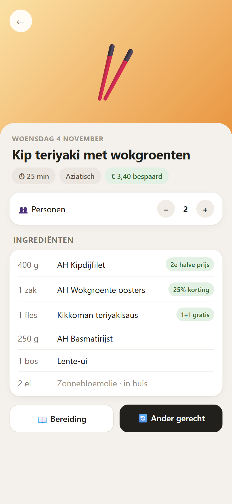 | 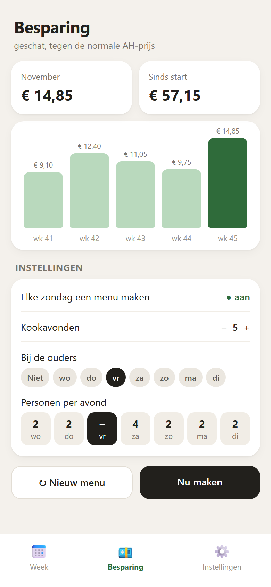 |

1. Card on the Home Assistant dashboard
2. The week in the Weekmenu app
3. One dish, with swap and preparation
4. Savings and settings

## De echte app (testdata)

Screenshots of the built Weekmenu app, made by `weekmenu/tests/test_frontend.py` in headless Chrome at phone size (390 × 844). The data is test data: no real menu, account or order. Without Allerhande photos each dish shows its colour block.

| | |
|---|---|
| 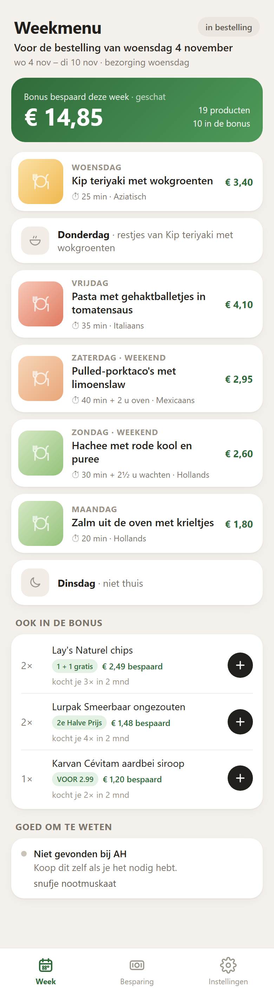 | 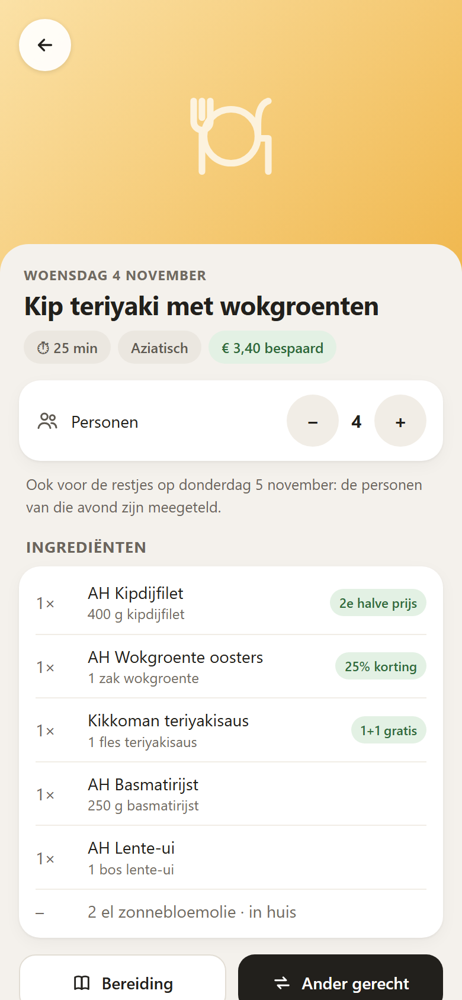 |
| 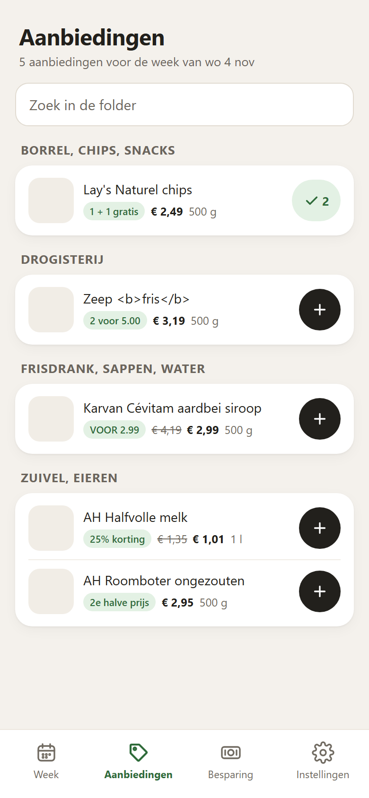 | 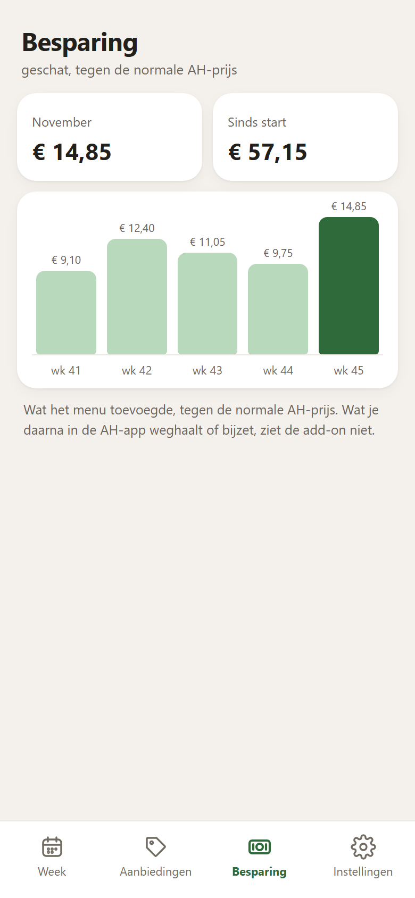 |
| 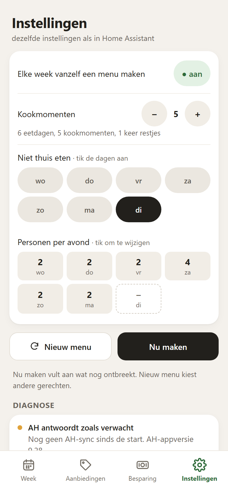 | 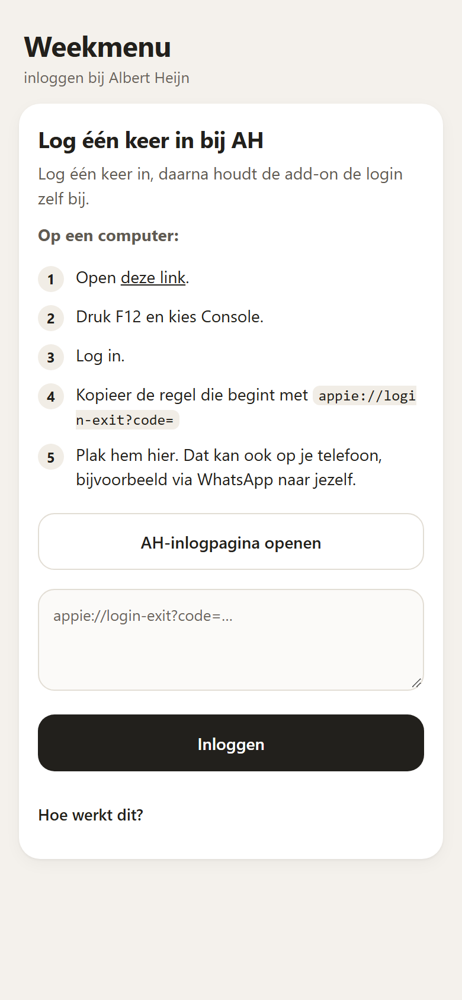 |
| 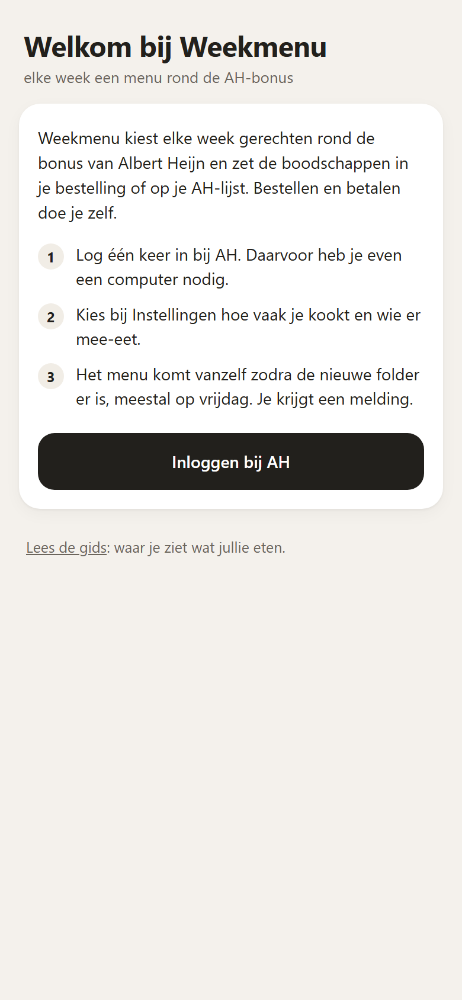 | |

1. Week: under the title the order it is for ("Voor de bestelling van woensdag 4 november"), then "Vanavond" (tonight's dish and when to start), then the savings of the week, then one card per evening, an evening not at home and a leftover night ("Donderdag · restjes van ...") as quiet cards, and under the dishes "Ook in de bonus": staples bought often that are on offer, each with a plus button
2. One dish: persons, ingredients with the AH product and the bonus offer, preparation and swap
3. Aanbiedingen: the whole bonus folder of the menu week per category with a search field on top; each product has its photo, the action, the price (old price struck through) and a plus button that becomes a check with the quantity once added
4. Savings: this month, since the start, and per week
5. Settings: the same helpers as in Home Assistant: Kookmomenten with the explanation "6 eetdagen, 5 kookmomenten, 1 keer restjes", "Niet thuis eten" chips per day, plus Nieuw menu and Nu maken
6. Login: a step plan (on a computer: open the link, F12 and Console, log in, copy the `appie://login-exit?code=` line, paste it here, also from a phone), with the F12 explanation under "Hoe werkt dit?"
7. Welcome: the first start, without a login or a menu: what the add-on does in three steps
